 

 

**Google ADK Python** · Issue [#8364](https://github.com/google/adk-python/issues/8364)
&nbsp;&nbsp;|&nbsp;&nbsp;
**Apache SeaTunnel** · Issue [#12707](https://github.com/apache/seatunnel/issues/12707) · PR [#13402](https://github.com/apache/seatunnel/pull/13402)

 

### Gemini context caching &nbsp;

**Issue [#1937](https://github.com/google/adk-go/issues/1937) · PR [#1951](https://github.com/google/adk-go/pull/1951)**

Added Gemini context caching as an ADK Go feature. Gemini API calls store repeated prompt prefixes (instructions, tools, history) once and reuse them across turns, cutting input tokens. Built invalidation and cleanup, persisted in SQL sessions.

**In plain terms:** every turn of a chat normally re-sends the same long prefix (the agent's instructions, its tool definitions and the earlier conversation), and you are billed for those input tokens every time.

- **Turn 1:** the agent sends the full prompt, as usual.
- **Turn 2:** once the same prefix has repeated, it is stored on Gemini's servers as a cache. The request now says "use cache X" and only sends the new message, so the repeated part isn't billed again at full price.
- **Keeping it correct:** if the instructions or history change, the old cache is invalidated and replaced. Old caches are deleted after the reply reaches the user, and the cache's reference is saved with the session in SQL, so it survives restarts.

It is opt-in: caching stays off unless you configure it.

### More merged work

| Status | PR | What was wrong, and what I did | Issue |
|:---:|:---:|---|:---:|
|  | **[#2434](https://github.com/google/adk-go/pull/2434)** | **Claude refusals and cut-off replies looked like successful empty answers.** When Claude stopped with no content (a refusal or `max_tokens`), no error code was set, so agents treated the turn as a success. It is now reported as a model error on both streaming and non-streaming paths. | [#2433](https://github.com/google/adk-go/issues/2433) |
|  | **[#2401](https://github.com/google/adk-go/pull/2401)** | **Prompt placeholders failed inside callbacks, plugins and tools** with `unexpected context type`. `{key}` and `{artifact.name}` now resolve from those contexts too, and session state is still read only when needed. | [#2399](https://github.com/google/adk-go/issues/2399) |
|  | **[#2400](https://github.com/google/adk-go/pull/2400)** | **Memory search missed words in mixed-language queries**, so `Pythonについて教えて` found nothing about Python. Queries are now split the same way as stored text, and lowercasing no longer breaks words into false partial matches. | [#2398](https://github.com/google/adk-go/issues/2398) |
|  | **[#1748](https://github.com/google/adk-go/pull/1748)** | **Optional prompt placeholders like `{user_data?}` swallowed every error**, even a dead database, and the agent carried on with a broken prompt. Now only a genuine "not found" is ignored. | [#1747](https://github.com/google/adk-go/issues/1747) |
|  | **[#1729](https://github.com/google/adk-go/pull/1729)** | **Vertex AI memory silently dropped code-execution and file data**, so agents forgot the code they had run and made things up on the next turn. Added the missing round-trip serialization. | [#1728](https://github.com/google/adk-go/issues/1728) |

 

### Mixed-precision NaN guard &nbsp;

**Issue [#173885](https://github.com/pytorch/pytorch/issues/173885) · PR [#173989](https://github.com/pytorch/pytorch/pull/173989)**

FP16/BF16 training can overflow to infinity, and `∞ − ∞` silently produces NaNs that corrupt a model. Root-caused it in `torch.compile` and shipped a CPU/GPU guard that forces the difference to zero. Independently adopted by **Amazon's AWS** PyTorch team in production ([commit a5d7261](https://github.com/amazon-contributing/upstream-to-pytorch/commit/a5d7261)).

**In plain terms:** half-precision numbers have a small range, so a large value can become infinity partway through a calculation.

- **The symptom:** with `torch.compile` on CPU in float16, `LayerNorm` returned NaN when the input contained infinity, unlike eager mode and the CUDA backend.
- **The cause:** the running variance calculation (Welford's method) ended up computing `∞ − ∞`.
- **The fix:** a guard catches the non-finite result and resets it to zero, so the output stays numerically stable.

 

### A pip install launcher for SeaTunnel &nbsp;

**Issue [#12707](https://github.com/apache/seatunnel/issues/12707)** · co-developing

**The problem.** To try SeaTunnel today you download a **~470 MB** package, unpack it, set environment variables, make sure Java is installed and add connectors by hand. That is a lot of setup before a first run, especially in notebooks and CI.

**The goal:** `pip install` and go. A small Python package that fetches and verifies the official engine on first run, then launches it. I'm building it as small, reviewable steps:

| Step | PR | Status | What it does |
|:---:|:---:|:---:|---|
| 1 | [#12740](https://github.com/apache/seatunnel/pull/12740) |  | **Fail-fast JDK check:** finds Java, checks the version and gives a clear fix-it message instead of a cryptic JVM crash |
| 2 | [#12857](https://github.com/apache/seatunnel/pull/12857) |  | **SDK CI:** the Python SDK now builds and checks itself automatically on every PR |
| 2b | [#12994](https://github.com/apache/seatunnel/pull/12994) |  | **CI follow-up:** pinned the workflow to ubuntu-24.04 so Python 3.9 installs reliably |
| 3 | [#12858](https://github.com/apache/seatunnel/pull/12858) |  | **Plugin installer:** enables only the connectors you ask for, with atomic writes and a byte-exact rollback if anything fails |
| 4 | [#13402](https://github.com/apache/seatunnel/pull/13402) |  | **Cache location and download URL:** gives each user a per-version cache folder and builds the official release URL, with strict checks on versions and mirror addresses |

### More merged work

| Status | PR | What was wrong, and what I did | Issue |
|:---:|:---:|---|:---:|
|  | **[#12573](https://github.com/apache/seatunnel/pull/12573)** | **The Paimon connector accepted blank warehouse, database and table values** and only failed later at runtime. Added declarative `notBlank` validation so bad config is rejected when the job is submitted. | [#11007](https://github.com/apache/seatunnel/issues/11007) |

 

| Status | PR | What was wrong, and what I did | Issue |
|:---:|:---:|---|:---:|
|  | **[#41405](https://github.com/apache/beam/pull/41405)** | **One failed model load left a worker stuck.** After a transient error in a multi-model `KeyedModelHandler`, the model was reloaded on every batch, and evicting or updating it crashed with `KeyError`. A failed load now leaves nothing behind, so the next batch retries and caches it normally. | [#41404](https://github.com/apache/beam/issues/41404) |
|  | **[#41389](https://github.com/apache/beam/pull/41389)** | **ONNX and XGBoost pipelines silently ignored model updates** and kept predicting with the old model. Both handlers now load the new model path, and ONNX predictions report which `model_id` produced them. | [#41384](https://github.com/apache/beam/issues/41384) |

 

> **Note:** the Microsoft repository is temporarily private for security reasons. The links below will work again once it is back.

### Time limits for agent tool loops &nbsp;

**Issue [#7587](https://github.com/microsoft/agent-framework/issues/7587) · PR [#7772](https://github.com/microsoft/agent-framework/pull/7772)**

Added a wall-clock limit for tool loops that is fair to human-approval pauses and stops gracefully instead of crashing.

**The problem.** Agents can call tools in a loop. The framework limited the number of calls but not the time. An agent stuck on slow APIs could run for a very long time and cost money. And when it stopped, the developer could not tell why: did it finish, or just hit a limit?

- **The limit:** added `max_duration_seconds` and a `stop_reason` in `FunctionInvocationLayer`.
- **Fair timing:** the timer is stored in the session, so it pauses while a human is approving something and the agent is not blamed for the human's delay.
- **Graceful stop:** when time runs out, tools are switched off and the model is asked for a final summary instead of crashing.
- **Reliable tests:** rewrote fragile tests with a fake clock so they give the same result every time.

It went through several rounds of review by Microsoft engineers, where handling the timer across async streams was the hard part. **The impact:** developers can cap run time and react to the exact stop reason.

### Background tasks that go missing across servers &nbsp;

**Issue [#8760](https://github.com/microsoft/agent-framework/issues/8760):** the background-task provider cannot tell a task running on *another server* from one whose owner *died*.

**The problem.** An agent can start a background task ("research this while we keep chatting"). The task has two halves: a **saved record** (status, result) that travels with the conversation, and the **live work**, which exists only in the memory of the one server that started it. When the next message lands on a *different* server, that server sees "marked running, but I can't find it" and declares the task **LOST**. It can't tell "the server crashed" from "it's just running somewhere else". The result:

- **Duplicate work:** the model restarts a "lost" task while the original is still running, so you pay twice and two writers can touch the same files
- **Lost results:** when the original finishes, nobody records its answer
- **Zombie tasks:** deleting a conversation on one server doesn't stop its tasks on another

I'm fixing this in two phases.

**Phase 1: PR [#9387](https://github.com/microsoft/agent-framework/pull/9387)** &nbsp;

A finished task was deleted from memory the instant it completed, so restoring a session snapshot taken *while it was running* could not find it and threw the result away. Finished tasks are now kept until they are cleared, every run is tagged with an execution ID so a stale snapshot can never pick up another run's result, and `release_session(timeout=...)` returns on time even if a task ignores cancellation.

**Phase 2: architecture decision record** &nbsp;

I have submitted the **ADR** for the real cross-server design, and will start implementing it as soon as the Microsoft team accepts it.

### More work

| Status | PR | What was wrong, and what I did | Issue |
|:---:|:---:|---|:---:|
|  | **[#8774](https://github.com/microsoft/agent-framework/pull/8774)** | **Errors in streaming hooks vanished silently.** If a hook or mapper crashed mid-stream, the stream never recorded the error, so monitoring spans closed looking healthy. I moved that code inside the stream's error handling. | [#8765](https://github.com/microsoft/agent-framework/issues/8765) |
|  | **[#6052](https://github.com/microsoft/agent-framework/pull/6052)** | **AWS Bedrock couldn't return structured output.** Built the schema translation layer and a precise wire format, with nested schemas and multiple input shapes. | [#5966](https://github.com/microsoft/agent-framework/issues/5966) |
|  | **[#7283](https://github.com/microsoft/agent-framework/pull/7283)** | **FoundryAgent inherited a stray `OPENAI_CHAT_MODEL`** that broke valid requests. Fixed at the source and stripped defensively as a second layer. | [#7272](https://github.com/microsoft/agent-framework/issues/7272) |
|  | **[#5947](https://github.com/microsoft/agent-framework/pull/5947)** | **MCP servers with 50–200+ tools flood the model's context.** Added `as_progressive_tools()` to discover tools progressively. A maintainer shipped a broader version in [#6233](https://github.com/microsoft/agent-framework/pull/6233) (merged). | [#5821](https://github.com/microsoft/agent-framework/issues/5821) |

 

### [PrismAI](https://github.com/karthik-0306/PrismAI): multi-agent LLM orchestration platform

No single LLM is best at everything, so PrismAI acts as a router. A FastAPI engine classifies each query into **9 domains**, splits it into sub-queries, sends them in parallel to the best model, **judges** every answer on a 0–3 severity scale (re-splitting and retrying bad ones) and merges the results through **LiteLLM** fallback chains across Groq and Gemini.

- **Query rewriter:** compresses verbose prompts, accepted only if the meaning stays above **0.80** cosine similarity. **16.92%** average token reduction on LMSYS-Chat-1M.
- **Conversation memory:** once a chat uses 60% of the model's context window, older messages are folded into a rolling summary and the latest turns stay verbatim.
- **Subagents:** DSA solver with step-by-step (CoT) output, Tavily web search with cited sources, and a **3-judge EvaluatorSubagent** scoring answers on 7 metrics.

`Python` `FastAPI` `LiteLLM` `React`

**[Repository](https://github.com/karthik-0306/PrismAI)** · **[Live Demo](https://prism-ai-rust.vercel.app/)**

---

### [ContextClosest](https://github.com/karthik-0306/ContextClosest): hybrid multimodal product search

Cleans **147K** raw Amazon Berkeley Objects listings into **56K** indexed products and fuses **LoRA-fine-tuned SigLIP 2** image/text embeddings (768-dim, trained with PEFT) with **SPLADE** sparse vectors using **Reciprocal Rank Fusion**. Vectors live in **Qdrant Cloud**, images and metadata on **AWS S3**, and a **FastAPI** backend serves queries serverlessly on **Modal**.

`PyTorch` `SigLIP 2` `Qdrant` `FastAPI` `Modal`

**[Repository](https://github.com/karthik-0306/ContextClosest)** · **[Live Demo](https://karthik-0306--contextclosest-search-web.modal.run/)**

---

### [Volatility Forecasting with TimeMixer](https://github.com/karthik-0306/Volatility-Forecasting-in-Global-Financial-Markets-Using-TimeMixer)

A **TimeMixer** model forecasting volatility across **4 asset classes** (equities, ETFs, crypto, forex) and **5 horizons** (12 to 720 days), computed with **Yang-Zhang** estimators from live Yahoo Finance data. Against **GARCH(1,1)** it cuts MAE by **35%** and improves sMAPE by **39%**. Deployed as a live **FastAPI** service.

`Python` `PyTorch` `FastAPI`

**[Repository](https://github.com/karthik-0306/Volatility-Forecasting-in-Global-Financial-Markets-Using-TimeMixer)** · **[Live Demo](https://global-asset-volatility-forecasting.onrender.com/)**

 

**Let's connect**

